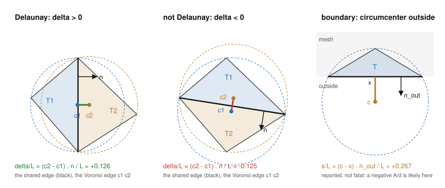
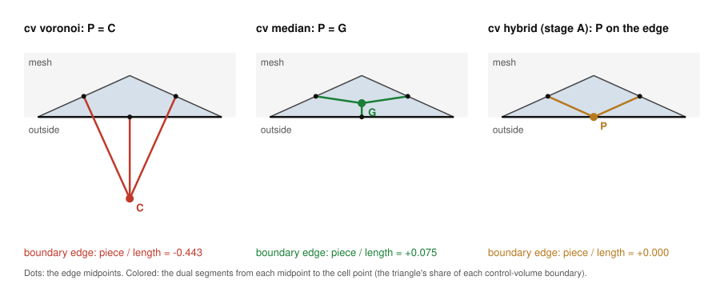

# del_vor manual

Voronoi control volumes from Delaunay meshes. This manual covers the
standalone program `del_vor`, as of phase 4 of 6. The LaGriT command
(`dump / control_volume`) is described in
[`lagrit/dump/DUMP_CONTROL_VOLUME.md`](lagrit/dump/DUMP_CONTROL_VOLUME.md).

Contents

1. [What del_vor does](#1-what-del_vor-does)
2. [Building](#2-building)
3. [Running](#3-running)
4. [The mesh file](#4-the-mesh-file)
5. [The mesh checks](#5-the-mesh-checks)
6. [The Delaunay check](#6-the-delaunay-check)
7. [The violations file](#7-the-violations-file)
8. [Control volumes and coefficients](#8-control-volumes-and-coefficients)
9. [Output files](#9-output-files)
10. [Fracture networks](#10-fracture-networks)
11. [The report](#11-the-report)
12. [Options](#12-options)
13. [Messages and exit status](#13-messages-and-exit-status)
14. [Tests](#14-tests)
15. [Comparing .stor files, and parity with LaGriT](#15-comparing-stor-files-and-parity-with-lagrit)
16. [Speed and memory](#16-speed-and-memory)

## 1. What del_vor does

del_vor reads a mesh of triangles (a 2D mesh, or a fracture network
in 3D) or of tets, and computes, for every vertex, its control volume
(the cell of the Voronoi diagram around it, cut to the mesh), and for
every mesh edge ij, the area A(ij) of the Voronoi face between i and
j and the edge length d(ij). These are the geometric coefficients of
two-point-flux finite-volume codes. del_vor writes them as FEHM
`.stor`, PFLOTRAN `.uge` and TOUGH2 `MESH` files.

A run has four steps:

1. read the mesh;
2. check it: cell types, cells of positive size, conformity,
   orientation ([section 5](#5-the-mesh-checks)); a failure stops the
   run;
3. check that it is Delaunay, facet by facet
   ([section 6](#6-the-delaunay-check)); a facet that is clearly not
   Delaunay stops the run, because Voronoi coefficients of a mesh
   that is not Delaunay are wrong (overlapping Voronoi cells,
   negative areas); a facet only slightly off (nearly co-spherical,
   as from jitter or round-off) gives a warning;
4. compute the coefficients and write the output files.

Nothing is written unless every check passes, except the report and
the violations file, which say why.

## 2. Building

CMake 3.16 or later and a Fortran 2008 compiler (gfortran 9 or later,
or Intel Fortran). No libraries.

```
cmake -S . -B build -D CMAKE_BUILD_TYPE=Release
cmake --build build --parallel 6
```

This builds `build/del_vor` and the kernel self test
`build/del_vor_selftest`.

## 3. Running

```
del_vor -avs MESH.inp [-stor FILE] [-uge FILE] [-tough2 FILE]
        [-zero_area remove|keep] [-zero_tol X] [-compress on|off]
        [-cv voronoi|median|blend|hybrid] [-alpha X]
        [-hybrid_tol X] [-alpha_min X] [-hybrid_iter N]
        [-alpha_file FILE] [-delaunay_tol X] [-violations FILE]
        [-check_only on|off] [-report FILE]
```

Options are keyword / value pairs, in any order; the dash is
optional (`stor a.stor` is `-stor a.stor`). `del_vor -help` lists
them. [Section 12](#12-options) has the full table.

Examples:

```
del_vor -avs mesh.inp -stor mesh.stor
```
checks `mesh.inp` and writes the FEHM `.stor`.

```
del_vor -avs mesh.inp -stor mesh.stor -uge mesh.uge -tough2 MESH
```
three outputs from one run; the geometry is computed once.

```
del_vor -avs mesh.inp -check_only on -report mesh.report
```
checks the mesh only, and keeps a copy of the screen output in
`mesh.report`.

```
del_vor -avs mesh.inp -stor mesh.stor -zero_area keep -compress off
```
one matrix entry per mesh edge, zero-area ones included, every value
written out (the `.stor` most like LaGriT's `matbld2d`).

```
del_vor -avs mesh.inp -stor mesh.stor -cv hybrid -alpha_file alpha.vtu
```
control volumes moved away from Voronoi only where a coefficient
would be negative ([section 8](#control-volume-policies-cv)), with
the weight of each cell in `alpha.vtu` for ParaView.

lanl/voronoi's options `-type fehm|pflotran|tough2`, `-o FILE` and
`-compress` with no value also work, so old scripts run unchanged.

## 4. The mesh file

An AVS UCD file (`.inp`), as LaGriT's `dump / avs` writes it:

```
nvertices ncells nvertex_data ncell_data 0
1 x y z                         one line per vertex
...
1 itetclr tri  i j k            one line per cell
...                             (or: tet  i j k l)
nfields 1 1 ...                 vertex data, optional
imt1, integer
itp1, integer
1 imt1 itp1                     one line per vertex
...
```

- Cells are all triangles (`tri`) or all tets (`tet`). Other types,
  or a mix, are refused.
- The cell's second field is its material, `itetclr`.
- Tets are read in AVS vertex order and stored in LaGriT's (AVS
  1 2 3 4 = LaGriT 1 2 4 3, as LaGriT's `avs_cells.f`), so a tet
  LaGriT wrote with positive volume is read with positive volume.
- Vertex data named `imt1` (or `imt`), `itp1` (or `itp`) and `isn1`
  (or `isn`) are read; other vertex and cell data are skipped. `imt1`
  gives the TOUGH2 material of each vertex.
- Fields are separated by blanks or tabs; lines may end in LF or
  CR LF (Windows); blank lines are skipped; reals may have a Fortran
  `D` exponent (`1.0D+00`); a vertex's data may run onto more lines
  (LaGriT wraps them when a mesh has many vertex attributes).
- Coordinates are read as doubles, correctly rounded (the same
  doubles a Fortran read gives). LaGriT's `dump / avs` writes 13
  significant digits; that rounding shows in ties (see
  [section 6](#6-the-delaunay-check)) and in the last digits of the
  coefficients.

## 5. The mesh checks

Before any geometry, del_vor builds the face neighbors of every cell
(LaGriT's `jtet`) and checks the mesh. Each of these is fatal: the
run stops with exit status 1 and writes nothing.

| check | message | what is wrong |
|---|---|---|
| cell types | `mixed cell types; all triangles or all tets` | triangles and tets in one mesh |
| | `cell type quad not allowed; triangles or tets only` | any other cell type |
| | `cell refers to a vertex that does not exist` | a vertex number above the vertex count |
| positive size | `ERROR: N tets with zero or negative volume` | an inverted tet (negative volume in LaGriT's vertex order), a flat one, or one naming a vertex twice |
| | `ERROR: N triangles with zero area` | three vertices on one line |
| conformity | `ERROR: N tet faces shared by 3 or more tets` | not a conforming tet mesh |
| | `ERROR: N edges in 3 or more triangles of one itetclr` | a "book" of triangles in one surface |
| orientation | `ERROR: N pairs of neighboring triangles oriented differently` | two neighbors of one itetclr run along their shared edge the same way: one is turned over (or the surface, like a Moebius strip, cannot be oriented) |

Each ERROR line is followed by `first: cell ...` naming the first
cell (or pair of cells) found, so it can be looked at in LaGriT or
ParaView.

Not errors:

- A triangle mesh may run clockwise or counterclockwise, as long as
  each itetclr runs one way. Triangles are not compared across
  itetclr.
- Two tets of different itetclr sharing a face are a material
  interface (`jtet` = `mbndry` + the neighbor, as in LaGriT).
- An edge in triangles of 2 or more itetclr, 3 or more triangles in
  all, is a fracture intersection edge ([section
  10](#10-fracture-networks)).
- A vertex in no cell gets a WARNING (`vertices in no cell`; LaGriT's
  dudded vertices look like this) and no control volume.

The block ends with the counts:

```
del_vor mesh checks
  faces paired, same itetclr             685
  faces paired, other itetclr              0
  boundary faces                         166
  mesh checks passed
```

(for triangles: `edges paired`, `boundary edges`, and the number of
fracture intersection edges).

## 6. The Delaunay check



*Left and middle: the same four vertices with either diagonal. Right:
a boundary triangle. Drawn by `figures/make_figures.py` from the
coordinates shown.*

### Interior facets

A facet is a face of a tet, or an edge of a triangle. For each facet
shared by two cells T1 and T2, del_vor computes their circumcenters
c1 and c2 and

    delta = (c2 - c1) . n

with n the unit normal of the facet pointing from T1 into T2 (for
triangles, in the triangles' plane). delta is the signed length of
the Voronoi edge dual to the facet. It is positive when the facet is
locally Delaunay (the fourth vertex is outside the circle or sphere
of the other cell), zero when the vertices are co-circular or
co-spherical, and negative when it is not Delaunay (left and middle
of the figure). A mesh in which every facet is locally Delaunay is a
Delaunay mesh.

delta is judged relative to L, the facet's length (triangles) or the
mean of its three edge lengths (tets), so the test does not depend on
the units:

| delta/L | the facet is | |
|---|---|---|
| < -delaunay_fatal | not Delaunay | fatal: no coefficient file |
| between -delaunay_fatal and -delaunay_tol | slightly not Delaunay | a WARNING; the run goes on |
| between -delaunay_tol and delaunay_tol | a tie | accepted |
| > delaunay_tol | Delaunay | |

Every facet below -delaunay_tol goes to the violations file, warned
or fatal.

### delaunay_tol

The default, 1e-10, is set by what was measured on the test meshes
(compared with exact rational arithmetic, `test_delaunay`):

- True ties (co-circular or co-spherical vertices, common on grids
  and on Poisson disk meshes with a boundary buffer) compute to
  |delta/L| of at most 2.7e-16. With delaunay_tol 0, about one tie in
  seven comes out negative by round-off.
- The smallest real |delta/L| found was 4.1e-5 (tets) and 1.4e-4
  (triangles).

1e-10 lies between, with margin for coordinates rounded to 13 digits
by `dump / avs`.

### delaunay_fatal

A mesh is not rejected for a little jitter or round-off. Facets with
delta/L between -delaunay_fatal (default 1e-2) and -delaunay_tol are
slightly not Delaunay: their vertices are nearly co-circular or
co-spherical. del_vor says so and goes on:

```
  WARNING: 15 faces slightly not Delaunay (delta/L >= -1.0E-02):
    nearly co-circular / co-spherical; the coefficients there are
    accurate to about |delta/L| of a typical coefficient (violations file)
  Delaunay check passed (with the warning above)
```

Why this is safe: at such a facet the Voronoi edge dual to it has a
small negative length, delta, instead of a small positive one. That
changes the Voronoi faces of the facet's edges by about |delta| L, so
their coefficients by about |delta/L| of a typical coefficient. The
control volumes still add up to the mesh volume. An edge whose
coefficient is itself near zero (nearly co-spherical) can carry an
error as large as its value, so its sign is not reliable there; its
size stays tiny.

Where it comes from: LaGriT's `connect` does not always make an
exactly Delaunay mesh. On jittered grids (test_timing) it left 9
facets with delta/L down to -1.5e-5 in a mesh of 960,000 tets and 15
down to -3.6e-4 in one of a million tets (both confirmed in exact
arithmetic), and on Carl's Mac down to -3.7e-4 at 3 million tets and
-2.3e-3 at 10.4 million; none in 10 million triangles. In the
million-tet mesh no coefficient came out negative (the smallest A/d
was +9.5e-14, a near-zero face); the 45 edges of the 15 facets all
kept positive coefficients.

The default 1e-2 is about 4 times beyond the worst seen from
`connect`, and a real fault is far beyond it: the flipped edges and
faces of the test meshes give delta/L from -0.14 to -21. At
delta/L = -1e-2 a coefficient is off by about 1 % of a typical one. `delaunay_fatal` equal to
`delaunay_tol` makes every facet beyond the tolerance fatal (the
behavior before phase 3); a `delaunay_fatal` below `delaunay_tol` is
raised to it.

Circumcenters are computed relative to a vertex of the facet, so the
check gives the same answer at UTM-size coordinates (tested at
(7e5, 3.2e6, 1.5e3)) as at the origin.

### Facets between materials

A facet between two itetclr (a material interface) is tested the
same way and counted separately. In a triangle mesh only triangles of
one itetclr are paired, so a fracture network is tested fracture by
fracture.

### Boundary facets

For a facet on the boundary of cell T, del_vor measures how far T's
circumcenter c lies beyond the facet:

    s = (c - x) . n_out / L

with x a vertex of the facet and n_out the outward normal (right of
the figure). s > delaunay_tol means the circumcenter is outside the
mesh there (for triangles: the angle opposite the boundary edge is
obtuse). The Voronoi cell is then cut by the boundary, and a negative
coefficient at that edge is likely. These are counted and written to
the violations file, but never stop the run: many good meshes have
them, and they are a property of the boundary, not an error.

### Slivers

For each flagged facet del_vor also records R / shortest edge of its
cells (R the circumradius). Cells with a ratio above 5 are counted as
slivers. A large |delta| from a sliver may be round-off rather than
a real violation; the ratio in the violations file tells them apart.

### The report block

```
del_vor Delaunay check (delaunay_tol 1.0E-10, delaunay_fatal 1.0E-02)
  interior faces checked                 685
  ties (|delta/L| <= tol)                201
  violations                               0
    beyond delaunay_fatal                  0
  smallest delta/L -2.3733E-16  cells       178 and       250
    at  4.166667E+04  3.333333E+05  2.083333E+05  itetclr     1
  delta/L histogram
         -inf to  -1.0E-02                 0
     -1.0E-02 to  -1.0E-06                 0
     -1.0E-06 to  -1.0E-10                 0
     -1.0E-10 to   0.0E+00                27
      0.0E+00 to   1.0E-10               174
      1.0E-10 to   1.0E-06                 0
      1.0E-06 to   1.0E-02                 0
      1.0E-02 to      +inf               484
  boundary faces checked                 166
  boundary circumcenter outside            0
  slivers (R/shortest edge > 5)            0
  largest R / shortest edge       1.6583E+00
  Delaunay check passed
```

This is lanl/voronoi's `mesh_3D`: 201 ties, all within round-off (27
of them slightly negative), no violation. The histogram shows how
close the mesh comes to failing: counts in the three bins below
-1e-10 are violations; counts just above are near ties.

When there is a violation the block ends with

```
  Delaunay check FAILED: the mesh is not Delaunay beyond delaunay_fatal;
  no Voronoi coefficients are written. See the violations file.
```

and the run stops with exit status 1, after writing the violations
file and the report.

## 7. The violations file

When the Delaunay check flags any facet (a violation, or a boundary
circumcenter outside), del_vor writes the flagged facets to
`violations.vtu` (or the file given by `-violations`), whether or not
the run goes on. With nothing flagged, no file is written.

It is a VTK XML unstructured grid, in ASCII, which ParaView opens
directly. Open the mesh `.inp` in the same ParaView window (ParaView
reads AVS UCD) to see where the facets are. Each flagged facet is one
cell: a triangle (tet meshes) or a line segment (triangle meshes),
with its own copies of the facet's vertices.

| cell data | meaning |
|---|---|
| `kind` | 1 violation; 2 violation across a material interface; 3 boundary facet with the cell's circumcenter outside |
| `delta_over_L` | kinds 1 and 2: delta/L (negative); kind 3: s/L (positive) |
| `cell1`, `cell2` | the cells on either side (`cell2` = 0 for kind 3) |
| `itetclr1`, `itetclr2` | their materials |
| `ratio` | the larger R / shortest edge of the two cells (large: a sliver) |

| point data | meaning |
|---|---|
| `vertex` | the mesh vertex number |

In ParaView: color by `kind` or `delta_over_L`; use Threshold on
`kind` to see only the violations; select a cell to read `cell1`,
`cell2` and the vertex numbers.

## 8. Control volumes and coefficients

For each cell, del_vor computes the Voronoi pieces from the cell's
circumcenter, its faces' and edges' circumcenters, and adds them to
the cell's vertices and edges. The cell-by-cell sums give, for every
vertex i, its control volume V(i) (an area for triangles), and for
every edge ij, the Voronoi face area A(ij) (a length for triangles)
and d(ij) = |x(j) - x(i)|. A(ij)/d(ij) is the coefficient of the
two-point flux between i and j.

The control volumes add up to the mesh volume; each run prints the
relative difference (round-off, about 1e-15). A boundary cell whose
circumcenter is outside gives a negative piece; the sums stay
correct, but an edge's total A(ij) can come out negative, and the
summary counts those (`negative A(ij)`).

### Control-volume policies (cv)

Where each cell's dual point goes (design document, section 9). A
cell T gets a weight alpha(T) from 0 to 1 and its point is

    P(T) = G(T) + alpha(T) (C(T) - G(T))

with C the circumcenter and G the centroid. In 3D each face point is
the same blend of the face's circumcenter and centroid, with
alpha(f) = min(alpha(T1), alpha(T2)) over the face's two tets, so
the two halves of a dual face meet and every control volume stays
closed. Edge midpoints never move. Whatever the points, the volumes
add up to the mesh volume.

| `cv` | alpha | Delaunay check | use |
|---|---|---|---|
| `voronoi` (default) | 1 everywhere | required | true Voronoi control volumes; faces perpendicular to edges |
| `median` | 0 everywhere | advisory: reported, the run goes on | meshes that are not Delaunay; never negative in 2D |
| `blend` | `alpha X` everywhere | required | sensitivity studies |
| `hybrid` | per cell, the largest with no negative coefficient | required | an M-matrix from a mesh that cannot be repaired |



Above: a boundary triangle whose angle opposite the boundary edge is
obtuse. With Voronoi its circumcenter lies outside, and its piece of
the boundary edge's coefficient is negative. With median it is
positive. The hybrid's stage A puts the point on the edge, so the
piece is 0. (Drawn by `figures/make_figures.py`.)

**The hybrid** keeps alpha = 1 (Voronoi) wherever it can:

1. **Stage A** (closed form, one pass). For a cell with an exterior
   boundary facet beyond which its circumcenter lies, alpha is set so
   that P lands on that facet:
   alpha = b / (b - lam), where lam < 0 is the circumcenter's
   barycentric coordinate at that facet and b = 1/(d+1) the
   centroid's (1/3 for triangles, 1/4 for tets). In 3D, a boundary
   face whose circumcenter lies outside its triangle has its face
   point clamped into the triangle the same way.
2. **Stage B** (correction). The coefficients are assembled, and
   every edge is checked. Inside a Delaunay mesh the Voronoi
   coefficients are never negative, but moved points (and nearly
   Delaunay meshes) can make interior edges negative too. On each
   negative edge, the cell with the most negative piece has its alpha
   lowered just enough that the edge's total is 1e-3 of the sum of
   its pieces (aiming slightly above 0 keeps a neighbor's later move
   from undoing it). Its face points follow. Then only the cells
   that changed, and their face neighbors, are updated, and the pass
   repeats. Alpha only decreases, so this ends.

An edge counts as negative when A(ij) < -hybrid_tol times the sum of
|its cells' pieces|, unless it is a zero-area edge (|A| <= zero_tol
d², above): round-off on co-spherical ties is not a negative
coefficient. Edges still negative when every cell around them is at
`alpha_min`, or when `hybrid_iter` passes are used up, give a
WARNING; the files are still written.

Measured (test_policy):

- On LaGriT's test_poisson_3d case 1, stage A alone removes all 75
  negative coefficients; 108 boundary tets get alpha < 1 (the
  smallest 0.141). The rest stays Voronoi.
- On random points connected by LaGriT (a square and a cube, with
  random points on the boundary), stage A fixes the boundary but
  makes interior edges negative; stage B removes them in 3 (2D) and
  18 (3D) passes. On a million such tets: 48 passes, 2 s.
- With nothing to fix, the hybrid's `.stor` is byte for byte the
  Voronoi one.
- `blend` with alpha 0.5 on the same 3D mesh has 21 negative
  coefficients, against 75 for Voronoi and 0 for median: in 3D a
  coefficient is not linear in alpha, because cell and face points
  both move. In 2D it is linear.

`alpha_file FILE` writes the mesh as a VTK file for ParaView, with
cell data `alpha`, `stage` (0 untouched, 1 stage A, 2 stage B),
`negative` (1 on the cells of an edge still negative) and `itetclr`.

### Zero-area connections

On co-circular or co-spherical vertices (the ties of the Delaunay
check) some edges get a Voronoi face of zero area: they are mesh
edges, but not Voronoi neighbors. With `-zero_area remove` (the
default) they are left out of every output file; with `-zero_area
keep` the coefficient matrix has one entry per mesh edge, zero ones
included. An edge has zero area when

    |A(ij)| <= zero_tol d(ij)^2      (tets)
    |A(ij)| <= zero_tol d(ij)        (triangles)

with zero_tol 1e-12 by default. True zeros measured on the test
meshes are at most 1.3e-16 (relative), the smallest real faces 5.7e-10.
The control volumes are never changed by this choice.

## 9. Output files

Several outputs can be written in one run; with none given, del_vor
writes `voronoi.stor`. No two files of one run may share a name, and
no output may be named like the mesh.

**FEHM `.stor`** (`-stor FILE`): ASCII, in the layout LaGriT's
`matbld2d_stor` and `matbld3d_stor` write: the volumes, the row
pointers, the column numbers of every row (lower neighbors, itself,
upper neighbors, in increasing order), the pointers into the values,
the diagonal pointers, and the values -A(ij)/d(ij) (0 on the
diagonal). Volumes and values are written with 17 significant digits
(`1pe24.16`), enough to give back every double exactly; LaGriT's
`dump / stor` writes 13. FEHM reads these blocks list-directed, so
the wider fields need nothing on its side. With `-compress on` (the default), values equal within
1e-14 of the largest |value| are written once and shared through the
pointer block (LaGriT's `compressmatrixvalues` rule); with `-compress
off`, one value per matrix entry.

**PFLOTRAN `.uge`** (`-uge FILE`):

```
CELLS n
id  x  y  z  volume                one line per vertex
CONNECTIONS m
i  j  x  y  z  area                one line per edge, i < j
```

The connection point is the edge midpoint, as in lanl/voronoi.
Coordinates, volumes and areas have 17 significant digits; the
longest line is 128 characters (PFLOTRAN reads input lines of up to
512).

**TOUGH2 `MESH`** (`-tough2 FILE`): ELEME (one record per vertex:
name, material, volume, AHTX, x, y, z) and CONNE (one record per edge:
names, ISOT, d1 = d2 = d/2, area, BETAX = cos of the angle to
gravity), column for column as lanl/voronoi wrote them. The material
is the rank of the vertex's `imt1` among its distinct values. AHTX is
written equal to the volume, as lanl/voronoi did; this is an open
question for TOUGH2 users.

Unlike lanl/voronoi, `.uge` and `MESH` keep the sign of volumes and
areas (voronoi wrote absolute values, which hides negative
coefficients); a negative TOUGH2 number is written with one digit
less to fit its 10 columns. Whether this is what PFLOTRAN and TOUGH2
users want is also an open question.

## 10. Fracture networks

A fracture network from dfnWorks or LaGriT is a triangle mesh in 3D:
each fracture is a planar triangle mesh with its own itetclr, and
fractures cross along shared edges. An intersection edge is in two
triangles of each fracture that crosses there.

del_vor handles this directly:

- each edge is paired with the triangle of the same itetclr across
  it, so each fracture keeps its own neighbors;
- orientation is checked fracture by fracture: each fracture may run
  either way, independently of the others;
- the Delaunay check is made within each fracture, in its own plane;
- the coefficients of every fracture are added into one value per
  vertex pair, so an intersection edge gets both fractures' Voronoi
  faces, and a vertex on an intersection gets a control area from
  each fracture.

The mesh check block reports the intersection edges:

```
del_vor mesh checks
  edges paired, same itetclr            2025
  edges paired, other itetclr              0
  boundary edges                         168
  fracture intersection edges             16
  mesh checks passed
```

An edge in 3 or more triangles of one itetclr is still an error: it
is a fork within one fracture, not an intersection.

## 11. The report

Everything del_vor prints goes to the screen. `-report FILE` writes a
copy of it, line for line, to FILE, which is useful for scripts and
for runs whose screen output is lost. A run prints, in order:

1. `del_vor: reading MESH`;
2. the mesh checks ([section 5](#5-the-mesh-checks));
3. the Delaunay check ([section 6](#6-the-delaunay-check));
4. the summary (not with `check_only on`):

```
del_vor summary
  vertices                      116
  tets                          384
  edges                         582
  positive tets                 384
  negative tets                   0
  mesh volume   1.000000000000E+18
  sum of control volume   1.000000000000E+18
  relative difference -6.40E-16
  negative volumes                0
  zero-area edges               120  (zero_tol 1.0E-12)
  zero_area remove: left out of the output files
  negative A(ij)                  0
  minimum A(ij)/d(ij)  4.882812500000E+02
```

5. with `cv` other than `voronoi`, the policy block, here for the
   hybrid on test_poisson_3d case 1:

```
del_vor control volumes: hybrid
  negative coefficients    boundary  interior   smallest A/sum|A|
  Voronoi                       75         0    -1.00E+00
  after stage A                  0         0     0.00E+00
  after stage B                  0         0     0.00E+00
  alpha: 1 in        7680, 0 in           0, between in         108
  smallest alpha       0.140691399
  cells lowered: stage A         108, stage B           0
  stage B passes           0    alpha_min  0.000
  non-orthogonality: max  80.16 deg, area-weighted mean  0.366 deg
```

   The rows count negative coefficients (as the hybrid judges them)
   on boundary and interior edges at each step; "smallest A/sum|A|"
   is the most negative, relative to the sum of its pieces (-1: all
   pieces negative). Non-orthogonality is the angle between each dual
   face's vector area and its edge (0 for Voronoi), the price paid
   for positivity; the mean is weighted by area, because edges of
   nearly zero area have angles near 90 degrees that say little;
6. one line for each file written, e.g. `del_vor: wrote stor a.stor`.

## 12. Options

| keyword | value | default | meaning |
|---|---|---|---|
| `avs` | file | (required) | the mesh: AVS UCD, all triangles or all tets |
| `stor` | file | `voronoi.stor` if no output is given | FEHM `.stor` |
| `uge` | file | | PFLOTRAN `.uge` |
| `tough2` | file | | TOUGH2 `MESH` |
| `zero_area` | `remove`, `keep` | `remove` | `remove`: zero-area connections are left out of every file; `keep`: one connection per mesh edge |
| `zero_tol` | number >= 0 | `1e-12` | zero area: \|A\| <= zero_tol d² (tets), zero_tol d (triangles) |
| `compress` | `on`, `off` | `on` | `.stor`: each distinct value written once |
| `cv` | `voronoi`, `median`, `blend`, `hybrid` | `voronoi` | where each cell's dual point goes ([section 8](#control-volume-policies-cv)) |
| `alpha` | number from 0 to 1 | | `cv blend` only, and required there: 1 = Voronoi, 0 = median |
| `hybrid_tol` | number >= 0 | `0` | `cv hybrid` only: how negative a coefficient may stay, relative to the sum of its pieces |
| `alpha_min` | number from 0 to 1 | `0` | `cv hybrid` only: the lowest alpha it may give a cell |
| `hybrid_iter` | whole number >= 1 | `100` | `cv hybrid` only: the most stage B passes |
| `alpha_file` | file | none | the mesh with alpha and stage per cell, for ParaView |
| `delaunay_tol` | number >= 0 | `1e-10` | a tie within ±delaunay_tol; below -delaunay_tol a facet is not Delaunay |
| `delaunay_fatal` | number >= 0 | `1e-2` | between -delaunay_fatal and -delaunay_tol: a warning, the run goes on; below -delaunay_fatal: fatal |
| `violations` | file | `violations.vtu` | the flagged facets; written only when some facet is flagged |
| `check_only` | `on`, `off` | `off` | `on`: the mesh and Delaunay checks only; no coefficient file is written |
| `report` | file | none | a copy of the screen output |
| `timing` | `on`, `off` | `off` | development only: the wall and CPU time of each step and the peak memory, at the end of the report |

lanl/voronoi's `-type fehm|pflotran|tough2` with `-o FILE` (default
names `voronoi.stor`, `pflotran.uge`, `MESH_VORONOI`) and `-compress`
with no value are also accepted.

## 13. Messages and exit status

Exit status 0: every check passed and every file was written (with
`check_only on`: every check passed).

Exit status 1, and no coefficient file written:

| cause | message (examples) |
|---|---|
| an unknown keyword | `del_vor: unknown keyword -zero_areas`, then `del_vor: keywords are` and the list |
| a keyword with no value | `del_vor: keyword zero_tol needs a value` |
| a bad value | `del_vor: delaunay_tol -1: must be a number >= 0`, `del_vor: check_only maybe: must be on or off` |
| two files with one name | `del_vor: output file a.stor given twice` |
| an output named like the mesh | `del_vor: mesh.inp is the mesh; it would be overwritten` |
| no mesh | `del_vor: no mesh given (-avs MESH.inp)` |
| the mesh cannot be read | `read_avs: cannot open nothere.inp`, `read_avs: MESH: bad vertex line`, and the cell type messages of [section 5](#5-the-mesh-checks) |
| a mesh check fails | the ERROR lines of [section 5](#5-the-mesh-checks), then `del_vor: the mesh failed its checks (above)` |
| not Delaunay (delta/L < -delaunay_fatal) | `Delaunay check FAILED ...`, then `del_vor: not Delaunay; nothing else is written` (the violations file and the report are written). With `cv median` the run goes on instead: `del_vor: cv median does not need a Delaunay mesh: going on` |
| a keyword for another `cv` | `del_vor: alpha is for cv blend (here cv is hybrid)`, `del_vor: hybrid_tol is for cv hybrid (here cv is median)`, `del_vor: cv blend needs alpha (a number from 0 to 1)` |

gfortran adds the line `STOP 1` after the message.

## 14. Tests

```
cd test/suite
sh run_all.sh                  # every suite, a few seconds
JOBS=6 sh run_all.sh           # 6 suites at a time
```

then open `test/suite/summary.html`. Each suite judges del_vor
against answers worked out independently (formulas, exact
arithmetic, LaGriT's and lanl/voronoi's files), draws a picture of
every case, and has a page with a "What it does" note for each case.
`test/suite/README.md` lists the suites; each suite's `00README`
says what it checks and how. `test_timing`, for development, is not
run by default (`ONLY=timing sh run_all.sh`; it needs LaGriT and
makes big meshes).

## 15. Comparing .stor files, and parity with LaGriT

`tools/stor_compare.py` compares two `.stor` files of one mesh, pair
by pair and vertex by vertex, and labels every difference with what
explains it. It is how del_vor is compared with LaGriT
(`test_parity`), and it works on any two `.stor` files.

```
python3 -I tools/stor_compare.py A.stor B.stor --mesh MESH.inp
```

It prints the pairs in one file only, the largest differences with
the pairs and vertices where they are, the volume totals, a layout
check of each file, and `every difference explained` (exit 0) or
`UNEXPLAINED differences: N` (exit 1). Options: `--mesh` (needed for
some labels), `--eps` (LaGriT's `compress_eps`, default 1e-8),
`--zero_tol`, `--coord_digits`, `--json FILE`, `--worst N`.

| label | explains |
|---|---|
| `digits` | the same number printed with the fewer significant digits of the two files (13 for LaGriT, 17 for del_vor) |
| `round_off` | small values made by cancellation, within 64 u (1.4e-14) of the largest |
| `coord_digits` | coordinates rounded in the mesh file (with `--coord_digits`) |
| `merge` | LaGriT's compression stored one value for all within 1e-8 of the largest (anothermatbld3d) |
| `abs_coords` | LaGriT's 3D writer computes tet volumes from absolute coordinates |
| `nstor_magnitude` | LaGriT's old 3D writer stores \|A\|/d: negative coefficients come out with the wrong sign |
| `zero_area` | a zero-area pair left out by one of the codes |
| `dropped`, `dropped_share` | a pair below 1e-8 of the largest that LaGriT left out, and its share of its vertices' volumes |

`test_parity` compares del_vor with LaGriT's `dump / stor` on 14
meshes (lanl/voronoi's, LaGriT's Poisson meshes and level01 meshes, a
two-material mesh, a mesh at UTM-size coordinates, two fracture
networks) and, outside git, dfnWorks TPL_nonuniform (114,739
triangles). Every difference is explained; most pairs agree to all 13
digits LaGriT prints. Found in LaGriT along the way:

- In 3D, `dump / stor ... / none` uses LaGriT's old writer
  (`matbld3d_stor`), which stores \|A\|/d: every negative coefficient
  comes out positive (all 75 of LaGriT's test_poisson_3d case 1).
  The default `dump / stor` keeps the sign.
- At UTM-size coordinates, LaGriT's 3D volumes are wrong (a box of
  volume 0.032 gets -100.5); del_vor gets 0.0319999999944.

## 16. Speed and memory

Every step takes time in proportion to the mesh size. test_timing
fits log time against log size; on Carl's Mac (Intel, 6 cores; Nov
10, 2026), from 9,126 to 10.4 million tets and from 9,800 to 10
million triangles, the slope of del_vor's total is 1.02 (tets) and
1.01 (triangles), and of every step 0.995 to 1.042. LaGriT's
`dump / stor` alone grows a little faster (slopes 1.08 and 1.06).

| mesh | del_vor | peak | LaGriT read + `dump / stor` | peak |
|---|---|---|---|---|
| 1,019,162 tets | 7.2 s | 275 MB | 14.8 s | 424 MB |
| 3,003,241 tets | 20.3 s | 805 MB | 45.3 s | 1,190 MB |
| 10,404,079 tets | 74.8 s | 2,317 MB | 175.7 s | 3,459 MB |
| 996,872 triangles | 5.4 s | 338 MB | 11.6 s | 996 MB |
| 9,990,450 triangles | 60.4 s | 2,981 MB | 143.2 s | 6,433 MB |

del_vor is 2.4 times faster at 10 million cells and needs 1.5 (tets)
to 2.2 (triangles) times less memory: about 220 bytes per tet and 300
per triangle. The steps that do the work of `dump / stor` (edge CSR,
assembly, writing the `.stor`) take 37.7 s at 10.4 million tets,
against 140.2 s for `dump / stor`. del_vor's largest steps at 10
million cells: writing the `.stor` (37 % for tets, 64 % for
triangles) and `jtet` (32 % for tets).
